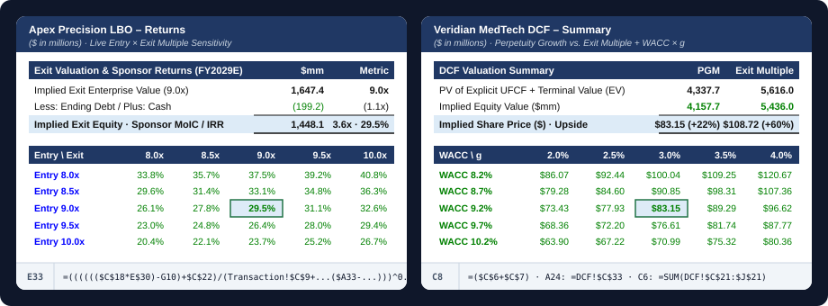
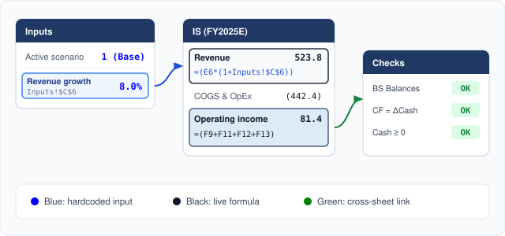
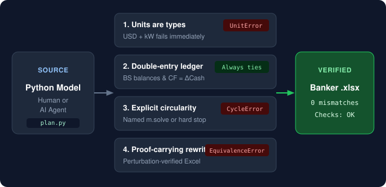

<p align="center">
  
</p>

<h1 align="center">boki</h1>

<p align="center">
  <b>事業計画はコードで書き、バンカー形式の Excel で出す。</b><br>
  事業を Python で書くと、3 表・LBO・DCF まで全セルが生きた式の Excel ワークブックをコンパイルする — エンジニアと AI エージェントのための財務モデリングライブラリ。
</p>

<p align="center">
  <a href="https://combinatrix.ai/boki/">Website</a> ·
  <a href="https://combinatrix.ai/boki/docs/">Docs</a> ·
  <a href="README.md">English</a>
</p>

<p align="center">
  
</p>

スプレッドシートのモデルは、差分も取れず、テストもレビューもできない。しかも一番難しい部分（循環参照、マクロで貼り付けた値、壊れたリンク）が一番見えにくい。**boki** はモデルを Python コードに置き、Excel を「元」ではなく「検証済みの出力」にする。

---

## すぐ試す

```sh
uv add "boki[excel]"   # または: pip install "boki[excel]"
```

boki 本体に必須の依存はなく、`[excel]` extra が `.xlsx` 出力用の `openpyxl` を追加する。

```python
import boki as b
from boki.lib import compound
from boki.units import USD, year

m = b.Model("Widget Co", start="2027-01", periods=5, step=year)
co = m.entity("Widget Co", standard=b.USGAAP, currency=USD)
co.bs.opening(cash=20e6 * USD)

growth = m.input("Revenue growth", 0.25)
sales = co.pl.revenue("Product sales", compound(40e6 * USD, growth))
co.pl.cogs("Cost of sales", 0.45 * sales)
co.pl.sga("Operating expenses", 6e6 * USD + 0.15 * sales)
co.bs.receivable("Accounts receivable", target=0.12 * sales)
co.bs.fixed_asset("Plant", 30e6 * USD, at=0, life=10 * year)
co.bs.loan("Term loan", draw={0: 25e6 * USD}, rate=0.07, repay=5e6 * USD)
co.pl.income_tax("Income taxes", rate=0.21, base=co.pl.pretax_income)

m.render().to_excel("widget.xlsx", money="$mm")
```

仕訳も減価償却スケジュールもキャッシュフロー計算書も手書きしていないが、`widget.xlsx` の全シート（`Inputs`, `IS`, `BS`, `CF`, `Schedules`, `Checks`, `Model`）に生きた数式として出力される。

---

## 投資銀行グレードのモデル例

実績期間と予測期間の境界（`actual_until` + `actuals=`、`FY2024A` | `FY2025E`）、検証付き Excel 数式書き換え（`b.row(..., formula=...)` / `b.block`）、ライブ `=INDEX` シナリオ切替（`Inputs!$C$3`）、2D サマリーパネル（`b.panel`）、軸見出しが生きた 2D 感応度表（`b.sensitivity`）、`Model` シート省略（`omit_unused_model=True`）を組み合わせて、提出品質の IB ワークブックを出力できる。

`examples/` に 3 本のベンチマークモデルを同梱し、`pytest` で全セル再計算の一致を**不一致 0 件**で自動検証している：

| モデル | サンプル | 主な構成 |
|---|---|---|
| **3-Statement** | [examples/ib_3statement](examples/ib_3statement/) | 実績 3 期（2022A–2024A）＋予測 5 期（2025E–2029E）、US GAAP、間接法 CF、Valuation & Credit Bridge、`Model` シートなし |
| **LBO** | [examples/ib_lbo](examples/ib_lbo/) | ライブ Sources & Uses、のれん・Pro Forma 開業 BS、TLA/TLB 2 トランシェ Debt Waterfall + 100% Cash Sweep、Exit Bridge、Sponsor IRR/MoIC、ライブ 2D 感応度表 |
| **DCF** | [examples/ib_dcf](examples/ib_dcf/) | CAPM WACC、Mid-Year 割引 UFCF、永久成長法＆Exit 倍率法の並列比較、ライブ 2D 感応度表（WACC×g / WACC×Exit 倍率） |

```sh
uv run python examples/ib_lbo/plan.py out/         # out/apex_lbo.xlsx を生成
uv run python examples/ib_dcf/plan.py out/         # out/veridian_dcf.xlsx を生成
uv run python examples/ib_3statement/plan.py out/  # out/acme_ib_3statement.xlsx を生成
```

---

## すべての数字が生きた式

<p align="center">
  
</p>

前提は `Inputs` に青字で 1 か所にまとまり、財務諸表の黒字数式へ流れ、`Checks` で自動検算される。Excel 上で成長率やシナリオ番号、感応度表の見出しセルを書き換えるだけで、ブック全体が即座に再計算される。

---

## AI エージェントと相性がよい — 間違いを通さない

<p align="center">
  
</p>

セル番地を直接いじるスプレッドシート編集は人間にも壊れやすく、LLM にはさらに厳しい。`boki` では Python コードとして書くことで、Excel に書き出す前に 4 つのガードレールがミスを止める：

1. **単位は型。** `USD` と `kW` を足すと即座に `UnitError` になる。
2. **複式簿記の台帳。** 全明細が複式仕訳として記帳されるため、貸借不一致の BS は作れず、`CF = 現金の増減` も全期で一致する。
3. **循環参照を明示する。** 借入額の逆算・建中金利・ゴールシークは `m.solve` で名前をつけて解き、意図しない循環は `CycleError` で止まる：
   ```python
   debt = m.unknown("Debt", unit=USD.dims)
   idc = m.series("Interest during construction", 0.08 * debt)
   m.solve(debt, debt == 1_000 * USD + idc)   # 1,086.96
   ```
4. **検証付き Excel 数式書き換え。** 冗長な展開式をきれいなバンカー形式の `=SUM(...)` ブロックに書き換える際、Base・全シナリオ・ランダム摂動で台帳との完全一致を証明してから出力する（不一致なら `EquivalenceError`）：
   ```python
   b.block(
       co.cf.operating,
       [co.pl.net_income, depreciation, change_in_nwc],
       label="Cash flow from operations",
       verify="perturb",
   )
   ```

ただの Python コードなので、Git で前提の差分をレビューし、`pytest` で合意済みの数字を固定できる：

```python
b.expect(m.render(), {co.pl.net_income: [7.9e6, 7.3e6, 11.5e6, 16.7e6, 23.2e6]}, rel=0.01)
```

---

## 検証

| 指標 | 実績 |
|---|---|
| `boki` で書き直した公開財務モデル | **228 本** |
| 元ブックの計算結果を再現したモデル | **211 本** |
| 元資料側で発見した内部不整合・誤り | **102 か所**（50 本中） |
| 出力 Excel における数式再計算の不一致 | **0 件** |

公的機関・大学が公開している 117 本の一覧と元資料の食い違いは [docs/public-models.md](docs/public-models.md) に記録している。

---

## 会計基準と主な機能

事業ロジックを 1 行も書き換えずに、**米国基準（US GAAP）・IFRS・日本基準（J-GAAP）** や `banker` / `sec`（10-K）/ `japanese` / `plain` スタイルを切り替えられる。

- **時間・実績**：月次・四半期・年次・混在期間、決算期（変則決算対応）、実績期間（`actual_until` + `actuals=`）と予測第 1 期への期首残高自動引き継ぎ。
- **会計**：複式簿記台帳、回収・支払サイト（`settle=`）、前受・前払按分（`recognize=`）、消費税/VAT、期首 BS、任意仕訳、直接法・間接法 CF。
- **資産・借入**：定額法・定率法・MACRS 税務償却、建設仮勘定＋建中金利、複数トランシェ借入・リボルバー・キャッシュスイープ。
- **連結**：非支配株主持分・のれん・持分法・原価法・内部取引消去・在外子会社換算。
- **税・財務関数**：法人税・繰越欠損金・段階税率、`npv`・`irr`・`xirr`・`pmt`・`wacc`・`capm`・`gordon`・`levelized`・`black_scholes`・範囲引き `lookup`。
- **Excel / Beancount**：カスタムシート配置（`b.sheet` / `b.section` / `b.row` / `b.link`）、検証付きブロック（`b.block`）、2D パネル（`b.panel`）、ライブ 2D 感応度表（`b.sensitivity`）、ライブシナリオ切替（`scenarios=`）、Beancount 出力。

---

## ドキュメント・状態

- **ウェブサイト**：[combinatrix.ai/boki](https://combinatrix.ai/boki/)
- **ユーザーガイド＆API リファレンス**：[combinatrix.ai/boki/docs](https://combinatrix.ai/boki/docs/)
- **その他の例**：[examples/neocloud](examples/neocloud/)（GPU クラウドのプロジェクトファイナンス）、[examples/quickstart](examples/quickstart/)
- **設計資料（英語）**：[docs/](docs/README.md)

**状態**：`v0.1`（pre-1.0。API は今後変わりうる）。まだないもの：表紙、会計基準ごとの会計方針の違い（のれんの償却、リース）。

## ライセンス

[MIT](LICENSE)。
