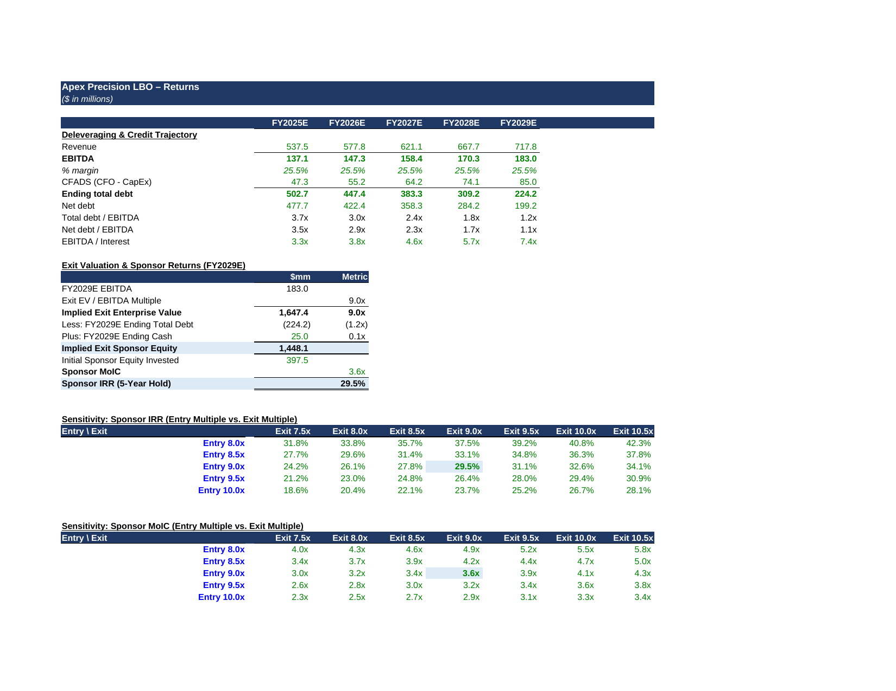

<p align="center">
  
</p>

<h1 align="center">boki</h1>

<p align="center">
  <b>事業計画はコードで書き、バンカー形式の Excel で出す。</b><br>
  事業を Python で書くと、全セルが生きた式の 3 表モデルができる。
</p>

<p align="center">
  <a href="https://combinatrix.ai/boki/">Website</a> ·
  <a href="https://combinatrix.ai/boki/docs/">Docs</a> ·
  <a href="README.md">English</a>
</p>

<p align="center">
  
</p>

スプレッドシートのモデルは、差分も取れず、テストもレビューもできない。しかも一番難しい部分（循環参照、マクロで貼り付けた値）が一番見えにくい。boki はモデルをコードに置き、Excel を「元」ではなく「出力」にする。

## 特長

### すべての数字が生きた式

<p align="center">
  
</p>

3 表は、行が科目・列が期間の Model シートを参照する。アナリストはどのセルでも監査でき、入力を変えれば全体に流れる。すべての式のセルを独立した計算エンジンで再計算し、boki と照合している。

### 会計は boki がやる

書くのは事業の中身（売上、費用、回収・支払の条件、設備、借入）だけ。仕訳、減価償却、利息、3 表は boki が作る。科目の並びと名前は会計基準（日本基準・IFRS・米国基準）に従い、決算期（変則決算も可）ごとに集計する。

```python
co.pl.revenue("売上", 1_200 * JPY, settle=b.delay(1))      # 入金は翌期
co.pl.cogs("小麦粉", 700 * JPY, settle=b.delay(1))         # 支払も翌期
co.bs.fixed_asset("オーブン", 600 * JPY, at=0, life=3 * year)
print(m.render().cf(co, method="indirect"))
```

```text
CF パン屋                         2027-04  2028-04  2029-04
  当期純利益                          500      300      300
  減価償却費等                          0      200      200
  売掛金の増減                     -1,200        0        0
  買掛金の増減                        700        0        0
営業活動によるキャッシュ・フロー        0      500      500
投資活動によるキャッシュ・フロー     -600        0        0
財務活動によるキャッシュ・フロー        0        0        0
現金の増減額                         -600      500      500
```

### 間違いを通さない

- **単位は型。** ドルとキロワットは足せず、モデルが組み立たない。
- **貸借が合わない BS は作れない。** すべての行が複式の仕訳で、3 表は 1 つの台帳のビュー。さらに実行のたびに、資産＝負債＋純資産、CF＝現金の増減、直接法と間接法の CF の一致を検査する。
- **サニティチェックもコード。** `m.check(co.bs.cash >= 0, "資金が尽きない")` は、すべてのシナリオの全期で評価され、失敗すると `render()` が止まる（結果は例外に付く。目標値は `level="warn"`、探索中は `render(checks="warn")`）。各エンティティは現金がマイナスにならないことも検査する。

```text
UnitError: cannot add 100,000 USD and Capacity (kW)
CheckFailed: never runs out of cash (fails in 2028, 2029)
```

### 難しいところを明示する

借入額の逆算（sculpting）、建中金利、キャッシュスイープ、ゴールシークは `m.solve` で名前をつけて解く。反復計算やマクロで貼り付けた値には頼らない。それ以外の循環参照は、見つけた輪を示して止まる：

```text
CycleError: circular reference: Debt -> Interest during construction -> Debt (in 2027)
Break it by reading an earlier period (x.lag(1)), or wrap the loop in m.solve(...).
```

```python
debt = m.unknown("Debt", unit=USD.dims)
interest = m.series("Interest during construction", 0.08 * debt)
m.solve(debt, debt == 1_000 * USD + interest)            # 1,086.96
```

### ただのコード

差分が取れ、レビューでき、テストが書ける。事業を Python のクラスにして、拠点ごと・世代ごとに作れる。シナリオや感応度はループで回す。合意した数字はテストで固定できる：

```python
def test_plan_matches_the_board_deck():
    b.expect(m.render(), {co.pl.net_income: [7.9e6, 7.3e6, 11.5e6, 16.7e6, 23.2e6]}, rel=0.01)
```

```diff
-growth = m.input("Revenue growth", 0.25)
+growth = m.input("Revenue growth", 0.20)
```

```text
AssertionError: values differ from the source:
  Widget Co: net_income [2028]: expected 7,300,000, got 6,675,500
  Widget Co: net_income [2029]: expected 11,500,000, got 9,985,600
  ...
```

### AI エージェントと相性がよい

エージェントは他のコードと同じようにモデルを書き換えられ、その間違いは単位・台帳・サニティチェックが止める。

> **公開されている 228 本のモデルで検証。** boki で書き直すと、そのうち 50 本の元のモデルに 102 か所の誤りや食い違いが見つかった。[検証を見る](#検証)

## すぐ試す

```sh
uv add "boki[excel]"   # または: pip install "boki[excel]"
```

boki 本体に必須の依存はなく、`[excel]` extra が Excel 出力用の `openpyxl` を追加する。

コードは [README.md の Quickstart](README.md#quickstart) と同じ（[examples/quickstart/plan.py](examples/quickstart/plan.py)）。仕訳も減価償却の表も CF も書いていないが、すべて `widget.xlsx` に入っている：

| シート | 中身 |
|---|---|
| **Inputs** | `m.input` の一覧（青）。モデルのパラメータ一覧 |
| **損益計算書** | 会計基準の並び、費用は括弧、小計は上の行の和、増収率・利益率・実効税率 |
| **貸借対照表** | 流動・固定、合計、負債純資産合計の二重線、全期 0 になる貸借の差の行 |
| **キャッシュフロー計算書** | 営業・投資・財務、増減、期首・期末の現金 |
| **明細（Schedules）** | 借入・固定資産・運転資本の増減表：期首残高、動きごとの行、期末残高 |
| **Checks** | すべての検査を全期で OK／FAIL：帳簿の整合と、各 `m.check` |
| **Model** | 系列が行、期が列、全部が式。補助行は折りたたみ |

## モデルの書き方

[README.md の Writing a model](README.md#writing-a-model) を参照。白紙から書いた例：[examples/neocloud](examples/neocloud/)（GPU クラウド。長さの違うコミット、契約に貸す借入、元利の準備金、キャッシュスイープ、感応度）。

## 投資銀行グレードのモデル例

実績期間と予測期間の境界（`actual_until` + `actuals=`、`FY2024A` | `FY2025E`）、検証付き Excel 数式書き換え（`b.row(..., formula=...)` / `b.block`）、ライブシナリオ切替（`Inputs!$C$3` + `=INDEX`）、2D サマリーパネル（`b.panel`）、軸見出しが生きた 2D 感応度表（`b.sensitivity`）、`Model` シート省略（`omit_unused_model=True`）を組み合わせて、提出品質の IB ワークブックを出力できる。

`examples/` に 3 本のベンチマークモデルを同梱し、`pytest` で全セル再計算の一致を自動検証している：

| モデル | サンプル | 主な構成 |
|---|---|---|
| **3-Statement** | [examples/ib_3statement](examples/ib_3statement/) | 実績 3 期（2022A–2024A）＋予測 5 期（2025E–2029E）、US GAAP、間接法 CF、Valuation & Credit Bridge |
| **LBO** | [examples/ib_lbo](examples/ib_lbo/) | ライブ Sources & Uses、のれん・Pro Forma 開業 BS、TLA/TLB 2 トランシェ Debt Waterfall + 100% Cash Sweep、Exit Bridge、Sponsor IRR/MoIC、ライブ 2D 感応度表 |
| **DCF** | [examples/ib_dcf](examples/ib_dcf/) | CAPM WACC、Mid-Year 割引 UFCF、永久成長法＆Exit 倍率法の並列比較、ライブ 2D 感応度表（WACC×g / WACC×Exit 倍率） |

<p align="center">
  
</p>

<p align="center">
  
</p>

## 検証

boki は、公開されている事業計画・アナリストのモデルを 1 行ずつ書き直し、元のブックと数字を照合しながら作ってきた。集めた 280 本のうち、空欄の様式や、例の数字がなく照合できないもの 52 本を除いた。残る 228 本はすべて書き直し、211 本が元の計算結果と一致する。一致しない 17 本のうち 16 本は元資料の性質（式を消して公開、乱数シミュレーション、マクロでの計算、入力と食い違う数字）により、1 本は boki にまだ週次の期間がないために照合できない。理由ごとの本数は [docs/public-models.md](docs/public-models.md) の末尾にある。一致した 211 本のうち、公的機関・大学が公開している 117 本は [docs/public-models.md](docs/public-models.md) に、公開場所、再現の程度、そして 50 本で見つかった元資料の中での食い違い 102 件（いずれも公開ファイルで確認済み）とあわせて載せた。書き直したモデルは元のブックをセル単位でなぞっているため、別のリポジトリに置いている。

boki が書き出す Excel も同じ基準で検査している。すべての式のセルを独立した計算エンジンで再計算し、モデルと照合する。

## 機能一覧

- **時間**：月次・四半期・年次。1 つのモデルで期間の長さを変えられる（建設中は月次、運転中は四半期）。決算期（決算期の変更も可）。営業日カレンダー。
- **会計**：日本基準・IFRS・米国基準の並びと、銀行の並び。回収・支払の条件（`settle=`）、前受・前払の按分（`recognize=`）、入出金の予定、消費税・付加価値税、期首の BS、任意の勘定の間の振替。
- **資産と借入**：定額法・定率法、税務の償却（MACRS）、建設仮勘定と建中金利、借入（実行・返済・目標残高・リボルバー）。
- **グループ**：連結（非支配株主持分・のれん）、持分法・原価法、内部取引の消去、在外子会社の換算（期末レート・期中平均レート）。
- **税**：課税ベースを指定する法人税、繰越欠損金、段階税率。
- **財務関数**：`npv`、`irr`、`xirr`、`pmt`、`wacc`、`capm`、`gordon`、`levelized`、`black_scholes`、範囲引きの `lookup`。
- **解く**：固定点、ゴールシーク、整数の探索（`m.solve`）。それ以外の循環は検出してエラー。
- **出力**：損益計算書・貸借対照表・CF（直接法・間接法）を期ごとか決算期ごとに。Excel は `banker`・`sec`（10-K）・`japanese`・`plain` のスタイルと上書き（`money="百万円"`、`units=`、`hide=`）、実績期間（`actual_until`）、検証付き数式書き換え（`b.block`）、2D パネル（`b.panel`）、ライブ 2D 感応度表（`b.sensitivity`）、ライブシナリオ切替（`scenarios=`）、Beancount 出力。
- **検査**：実行のたびの `m.check`、元のモデルの数字との `b.expect`・`b.compare`。

## 状態

v0.1（pre-1.0。API は今後変わりうる）。まだないもの：表紙、会計基準ごとの会計方針の違い（のれんの償却、リース）。

ドキュメント：[combinatrix.ai/boki/docs](https://combinatrix.ai/boki/docs/) · 設計資料（英語）：[docs/](docs/README.md)。

## ライセンス

[MIT](LICENSE)。
