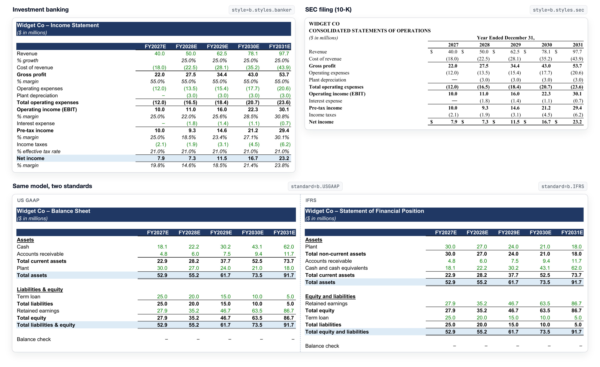
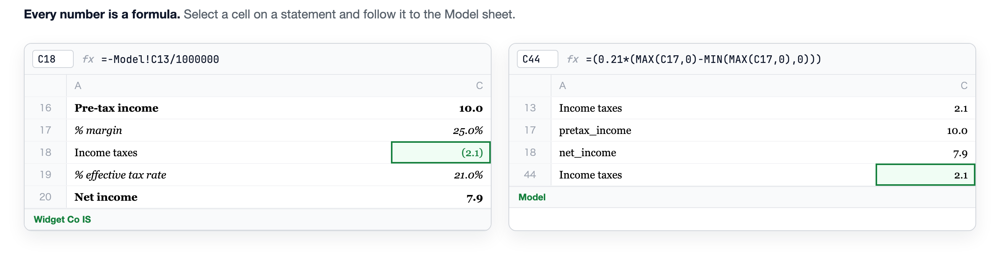
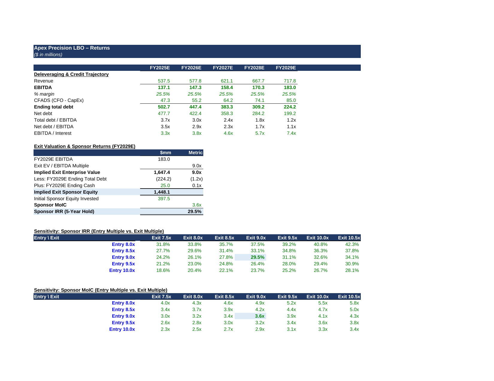
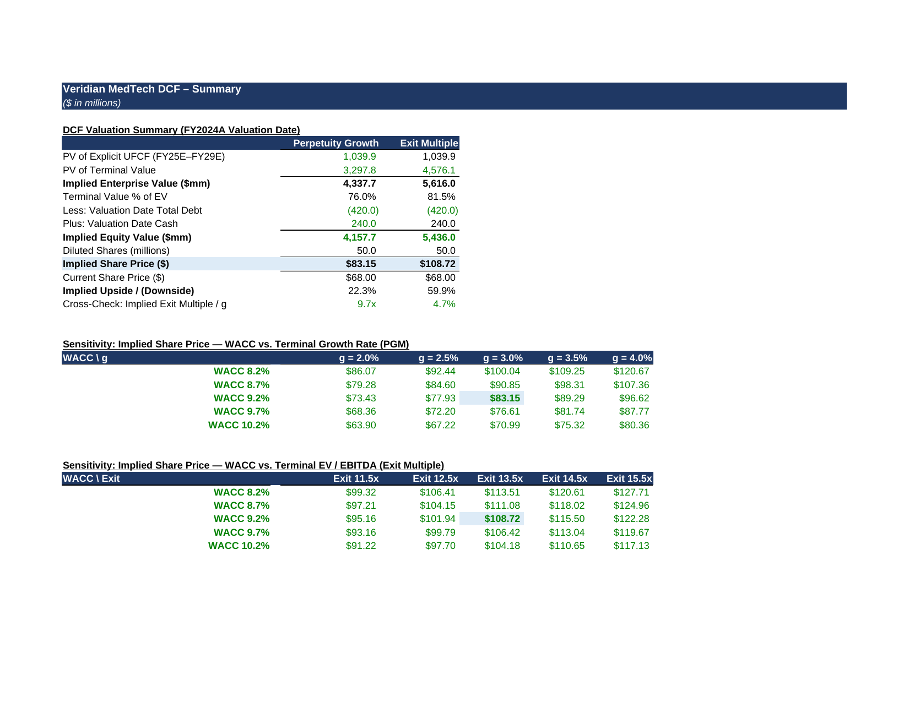

<p align="center">
  
</p>

<h1 align="center">boki</h1>

<p align="center">
  <b>Financial models as code. Banker-grade Excel as output.</b><br>
  Write the business in Python. Get a three-statement model where every cell is a live formula.
</p>

<p align="center">
  <a href="https://combinatrix.ai/boki/">Website</a> ·
  <a href="https://combinatrix.ai/boki/docs/">Docs</a> ·
  <a href="README.ja.md">日本語</a>
</p>

<p align="center">
  
</p>

Spreadsheet models cannot be diffed, tested or reviewed, and their hardest parts (circular references, macro-pasted values) are the least visible. boki keeps the model in code and makes Excel the output, not the source.

## Highlights

### Every number is a live formula

<p align="center">
  
</p>

The statements link to a Model sheet with one row per line item and one column per period. An analyst can audit any cell, change an input and watch it flow through. Every formula cell is recalculated by an independent engine and compared with boki.

### The accounting is done for you

You write the business: revenue, costs, payment terms, assets, loans. boki writes the journal entries, depreciation, interest and the three statements, with the line order and names of your standard (US GAAP, IFRS, J-GAAP), by fiscal year.

```python
co.pl.revenue("Sales", 120 * USD, settle=b.delay(1))    # customers pay a period later
co.pl.cogs("Flour", 70 * USD, settle=b.delay(1))        # and so do we
co.bs.fixed_asset("Oven", 60 * USD, at=0, life=3 * year)
print(m.render().cf(co, method="indirect"))
```

```text
CF Bakery                                  2027  2028  2029
  Net income                                 50    30    30
  Depreciation and other non-cash charges     0    20    20
  Change in Accounts receivable            -120     0     0
  Change in Accounts payable                 70     0     0
Cash flow from operations                     0    50    50
Cash flow from investing                    -60     0     0
Cash flow from financing                      0     0     0
Net change in cash                          -60    50    50
```

### Mistakes that cannot get through

- **Units are types.** Dollars and kilowatts do not add, and the model will not build.
- **The balance sheet cannot be unbalanced.** Every line is a double-entry posting and the statements are views of one ledger. Every run also checks that assets = liabilities + equity, that cash flow = change in cash, and that the direct and indirect cash flows agree.
- **Sanity checks are code.** `m.check(co.bs.cash >= 0, "never runs out of cash")` runs in every period of every scenario, and a failure stops `render()` with the full result attached (`level="warn"` for a benchmark, `render(checks="warn")` while exploring). Every entity also checks that cash never goes negative.

```text
UnitError: cannot add 100,000 USD and Capacity (kW)
CheckFailed: never runs out of cash (fails in 2028, 2029)
```

### The hard parts are explicit

Debt sculpting, interest during construction, cash sweeps and goal seeks are solved with `m.solve`, named in the model, not left to iterative calculation or pasted from a macro. Any other circular reference stops with the loop it found:

```text
CycleError: circular reference: Debt -> Interest during construction -> Debt (in 2027)
Break it by reading an earlier period (x.lag(1)), or wrap the loop in m.solve(...).
```

```python
debt = m.unknown("Debt", unit=USD.dims)
interest = m.series("Interest during construction", 0.08 * debt)
m.solve(debt, debt == 1_000 * USD + interest)            # 1,086.96
```

### It is just code

Diff it, review it, test it. Turn a project into a Python class and stamp out one per site or vintage. Run scenarios and sensitivities in a loop. Pin the numbers someone signed off on:

```python
def test_plan_matches_the_board_deck():
    b.expect(m.render(), {co.pl.net_income: [7.9e6, 7.3e6, 11.5e6, 16.7e6, 23.2e6]}, rel=0.01)
```

```diff
-growth = m.input("Revenue growth", 0.25)
+growth = m.input("Revenue growth", 0.20)
```

```text
AssertionError: values differ from the source:
  Widget Co: net_income [2028]: expected 7,300,000, got 6,675,500
  Widget Co: net_income [2029]: expected 11,500,000, got 9,985,600
  ...
```

### Agent-friendly

An AI agent can write and change a model like any other code, and the unit, ledger and sanity checks stop the mistakes it makes.

> **Checked against 228 public models.** Rewriting them in boki surfaced 102 errors or inconsistencies in 50 of the originals. [See the proof](#proof).

## Quickstart

```sh
uv add "boki[excel]"   # or: pip install "boki[excel]"
```

Core `boki` has no required dependencies; the `[excel]` extra installs `openpyxl` for `.xlsx` output.

```python
import boki as b
from boki.lib import compound
from boki.units import USD, year

m = b.Model("Widget Co", start="2027-01", periods=5, step=year)
co = m.entity("Widget Co", standard=b.USGAAP, currency=USD)
co.bs.opening(cash=20e6 * USD)

growth = m.input("Revenue growth", 0.25)
sales = co.pl.revenue("Product sales", compound(40e6 * USD, growth))
co.pl.cogs("Cost of sales", 0.45 * sales)
co.pl.sga("Operating expenses", 6e6 * USD + 0.15 * sales)
co.bs.receivable("Accounts receivable", target=0.12 * sales)
co.bs.fixed_asset("Plant", 30e6 * USD, at=0, life=10 * year)
co.bs.loan("Term loan", draw={0: 25e6 * USD}, rate=0.07, repay=5e6 * USD)
co.pl.income_tax("Income taxes", rate=0.21, base=co.pl.pretax_income)

r = m.render()
r.to_excel("widget.xlsx", money="$mm")
```

You did not write a journal entry, a depreciation schedule or a cash-flow statement. They are all in `widget.xlsx`:

| Sheet | What you see |
|---|---|
| **Inputs** | Every `m.input`, in blue: the model's parameter list |
| **Widget Co IS** (income statement) | Your standard's line order, expenses in parentheses, subtotals as sums of the lines above, % growth, % margin, effective tax rate |
| **Widget Co BS** (balance sheet) | Current and non-current, totals, a double rule under total liabilities & equity, and a balance check that is zero in every period |
| **Widget Co CF** (cash-flow statement) | Operating, investing, financing, net change, beginning and ending cash |
| **Widget Co Schedules** | Roll-forwards for debt, fixed assets and working capital: opening balance, each movement, closing balance |
| **Checks** | The books tie out, and each `m.check` holds, in every period: OK or FAIL |
| **Model** | One row per series, one column per period, all formulas. Helper rows are grouped and folded |

## Writing a model

```python
price = m.input("Price", 30 * USD, scenarios={"bear": 22 * USD})     # inputs and scenarios
users = m.series("Users")                                             # a series defined by its own past
users.define(users.lag(1, fill=1_000) * 1.05)

co.pl.revenue("Subscriptions", users * price, settle=b.delay(1))      # collected next period
co.bs.fixed_asset("Servers", 2e6 * USD, at="2027-06", life=5 * year)  # depreciation is booked for you
size = m.unknown("Debt size", init=1e6, unit=USD.dims)
co.bs.loan("Term loan", draw={"2027-06": size}, rate=0.08 / year, repay=size / 30)

m.solve(size, size == b.min(0.5 * users.sum() * price, 1.5e6 * USD))  # name what you solve for
m.check(co.bs.cash >= 0, "never runs out of cash")

for s in (None, "bear"):
    print(m.render(scenario=s)[size])                                 # scenarios are loops
```

A full model written this way, from scratch: [examples/neocloud](examples/neocloud/) (a GPU cloud with overlapping commitments, contract-backed debt, a debt service reserve, a cash sweep and a sensitivity grid).

## Investment-banking models

boki also builds presentation-ready IB workbooks with historical actuals (`actual_until` + `actuals=`, `FY2024A` | `FY2025E` divider), proof-carrying Excel formula rewrites (`b.row(..., formula=...)`, `b.block`), live scenario switching (`Inputs!$C$3` + `=INDEX`), 2D summary panels (`b.panel`), live 2D sensitivity tables (`b.sensitivity`), and optional omission of the `Model` sheet (`omit_unused_model=True`).

Three complete benchmark workbooks are included in `examples/` and verified automatically in `pytest` (every formula cell recalculated and checked with zero mismatches, plus LibreOffice visual verification):

| Model | Example | Highlights |
|---|---|---|
| **3-Statement** | [examples/ib_3statement](examples/ib_3statement/) | 3Y historical actuals (2022A–2024A) + 5Y forecast (2025E–2029E), US GAAP, indirect CF, Valuation & Credit Bridge |
| **LBO** | [examples/ib_lbo](examples/ib_lbo/) | Live Sources & Uses, Goodwill, Pro Forma Opening BS, 2-tranche Debt Waterfall + 100% Excess Cash Sweep, Exit Bridge, Sponsor IRR/MoIC, live Entry × Exit sensitivity |
| **DCF** | [examples/ib_dcf](examples/ib_dcf/) | CAPM WACC, mid-year discounted UFCF, Perpetuity Growth & Exit Multiple cross-check, live WACC × g and WACC × Exit Multiple sensitivity |

<p align="center">
  
</p>

<p align="center">
  
</p>

## Proof

boki was built by rewriting public financial models line by line and comparing the results with the source workbooks. Of 280 models collected, 52 were set aside as blank forms or examples with nothing to compare. All of the other 228 have been rewritten, and 211 reproduce their source. The other 17 cannot be compared: 16 because of the source itself (published without formulas, random simulation, macros, or figures that contradict their own inputs) and one because boki has no weekly periods yet; they are counted by reason at the end of [docs/public-models.md](docs/public-models.md). The 117 of the matching models published by public bodies and universities are listed in [docs/public-models.md](docs/public-models.md), with where each is published, how far the rewrite reproduces it, and 102 places in 50 of them where the source does not agree with itself, each checked against the published file. The rewritten plans follow their sources cell by cell, so they are kept in a separate repository.

The Excel boki writes is held to the same standard: every formula cell is recalculated by an independent engine and compared with the model.

## Features

- **Time**: monthly, quarterly or annual periods, and periods of different lengths in one model (monthly during construction, quarterly in operation). Fiscal years, including a change of year end. Business-day calendars.
- **Accounting**: US GAAP, IFRS and J-GAAP line orders and an industry layout for banks. Payment terms (`settle=`), deferred revenue and prepaid costs (`recognize=`), explicit cash schedules, VAT, an opening balance sheet, journal entries between any accounts.
- **Assets and debt**: straight-line and declining-balance depreciation, tax depreciation kernels (MACRS), construction in progress with capitalized interest, loans with draws, repayments, target balances and revolvers.
- **Groups**: consolidation with non-controlling interests and goodwill, the equity and cost methods, intercompany eliminations, foreign subsidiaries translated at closing and average rates.
- **Tax**: income tax on a base you choose, loss carryforwards, tax brackets.
- **Finance functions**: `npv`, `irr`, `xirr`, `pmt`, `wacc`, `capm`, `gordon`, `levelized`, `black_scholes`, banded `lookup`.
- **Solving**: fixed points, goal seek, integer searches (`m.solve`), with cycle detection everywhere else.
- **Output**: income statement, balance sheet and cash flow (direct and indirect) by period or fiscal year; Excel in `banker`, `sec` (10-K), `japanese` or `plain` style with overrides (`money="$mm"`, `units=`, `hide=`), historical actuals (`actual_until`), proof-carrying formula rewrites (`b.block`), 2D panels (`b.panel`), live 2D sensitivity tables (`b.sensitivity`), live scenario switching (`scenarios=`), and Beancount export.
- **Checks**: `m.check` on every render, `b.expect` and `b.compare` against a source model's numbers.

## How it works

1. **Series and evaluator.** Named, lazily evaluated time series with units, memoized pull evaluation, cycle detection and `m.solve` for the cycles you mean.
2. **Ledger.** Entities with an accounting standard, a fiscal calendar and a layout. Line items post double entries; the three statements, their checks and the Beancount export come from the ledger.
3. **Presentation.** Styles as data and an Excel writer that turns the expression graph into cell formulas.

Documentation: [combinatrix.ai/boki/docs](https://combinatrix.ai/boki/docs/) · Design notes: [docs/](docs/README.md).

## Status

v0.1 (pre-1.0 — the API may evolve). Not there yet: a cover sheet, accounting-policy differences between standards (goodwill amortization, leases).

## License

[MIT](LICENSE).
